# Diagrama entidad-relación

**Estado:** implementado. Refleja el esquema real en `develop` (después de
`alembic upgrade head`), no una propuesta.

Reemplaza el diagrama ASCII informal que había al final de
[MODELOS-COMPARTIDOS.md](MODELOS-COMPARTIDOS.md): este cubre las 24 tablas
del sistema completo (Módulo 1 y 2 de Joseph + Cotización/Materiales/
Inversores/Clientes/Proforma de Esteban + Validación de materiales), no
solo los modelos compartidos.

**El bloque `erDiagram` de abajo se genera, no se escribe a mano.**
Un diagrama hecho a mano se desactualiza en silencio — llegó a decir 17
tablas cuando ya había 24. `scripts/generar_diagrama_er.py` lee
`Base.metadata` (lo mismo que usa Alembic) y produce las entidades,
columnas, tipos, llaves y relaciones directo del esquema real:

```bash
cd 02_codigo_fuente/backend
python -m scripts.generar_diagrama_er
```

Y se reemplaza el bloque completo con la salida. Las notas de las dos
secciones siguientes (relaciones que no son FK, patrones del esquema) no
se generan — son lectura del esquema, no el esquema mismo — y se quedan
a mano.

---

## Diagrama completo

```mermaid
erDiagram
    BLOQUES_BOCETO {
        int id PK
        int boceto_id FK
        int orden
        string etiqueta "nullable"
        int paneles_largo
        int paneles_ancho
        int repeticiones
        string orientacion
        float confianza "nullable"
    }

    BLOQUES_LAYOUT {
        int id PK
        int layout_id FK
        int orden
        jsonb vertices
        int paneles_largo
        int paneles_ancho
        float proporcion
        boolean en_proporcion
        int inversor
    }

    BOCETOS {
        int id PK
        int proyecto_id FK, UK
        int usuario_id FK
        string nombre_archivo
        string formato
        int tamano_bytes
        bytes contenido
        string metodo
        jsonb advertencias
        int ediciones_manuales
        datetime created_at
        datetime updated_at
    }

    CAMINOS {
        int id PK
        int terreno_id FK
        string nombre "nullable"
        string tipo
        jsonb vertices
        datetime created_at
    }

    CLIENTES {
        int id PK
        string nombre
        string tipo_identificacion
        string identificacion UK
        string empresa "nullable"
        string email "nullable"
        string telefono "nullable"
        string direccion "nullable"
        boolean activo
        datetime created_at
        datetime updated_at
    }

    CONFIGURACIONES_EQUIPO {
        int id PK
        int proyecto_id FK, UK
        string panel_marca
        string panel_modelo
        float panel_potencia_wp
        float panel_largo_mm
        float panel_ancho_mm
        float panel_voc_v
        float panel_vmp_v
        float angulo_montaje
        float potencia_objetivo_kwp "nullable"
        datetime created_at
        datetime updated_at
    }

    COTIZACIONES {
        int id PK
        string numero_proforma UK "nullable"
        int usuario_id FK
        int cliente_id FK "nullable"
        int proyecto_id FK "nullable"
        string cliente_nombre
        string cliente_empresa "nullable"
        string cliente_email "nullable"
        string cliente_telefono "nullable"
        string proyecto_nombre "nullable"
        decimal addendum_porcentaje
        decimal subtotal "nullable"
        decimal addendum_monto "nullable"
        decimal iva_porcentaje "nullable"
        decimal iva_monto "nullable"
        decimal total "nullable"
        decimal potencia_kwp "nullable"
        int total_paneles "nullable"
        string estado
        datetime instalada_at "nullable"
        int instalada_por_id FK "nullable"
        datetime created_at
        datetime updated_at
    }

    DESPACHOS {
        int id PK
        int cotizacion_id FK, UK
        int usuario_id FK
        string fabricado_por
        string soldado_por
        string contado_por
        string despachado_por
        string destino
        string justificacion "nullable"
        datetime created_at
    }

    FOTOS_VALIDACION {
        int id PK
        int despacho_id FK "nullable"
        int recepcion_id FK "nullable"
        int material_id FK "nullable"
        string nombre_archivo
        string formato
        int tamano_bytes
        bytes contenido
        int conteo_ia "nullable"
        datetime created_at
    }

    INVERSORES {
        int id PK
        string marca "UK con (marca, modelo)"
        string modelo "UK con (marca, modelo)"
        float potencia_kw
        float vmax_v "nullable"
        float vmin_v "nullable"
        int mppts "nullable"
        int strings_por_mppt "nullable"
        boolean activo
        datetime created_at
        datetime updated_at
    }

    INVERSORES_EQUIPO {
        int id PK
        int configuracion_id FK "UK con (configuracion_id, orden)"
        int orden "UK con (configuracion_id, orden)"
        string marca
        string modelo
        float potencia_kw
        float vmax_v "nullable"
        float vmin_v "nullable"
        int mppts "nullable"
        int strings_por_mppt "nullable"
    }

    ITEMS_COTIZACION {
        int id PK
        int cotizacion_id FK
        string descripcion "nullable"
        int paneles_largo
        int paneles_ancho
        int bloques
        datetime created_at
        datetime updated_at
    }

    ITEMS_DESPACHO {
        int id PK
        int despacho_id FK "UK con (despacho_id, material_id)"
        int material_id FK "UK con (despacho_id, material_id)"
        string codigo
        string nombre
        int cantidad_cotizada
        int cantidad_despachada
        int conteo_ia "nullable"
    }

    ITEMS_RECEPCION {
        int id PK
        int recepcion_id FK "UK con (recepcion_id, material_id)"
        int material_id FK "UK con (recepcion_id, material_id)"
        string codigo
        string nombre
        int cantidad_esperada
        int cantidad_recibida "nullable"
        string estado
        string observacion "nullable"
    }

    LAYOUTS {
        int id PK
        int proyecto_id FK, UK
        int paneles_largo
        float pasillo_m
        float tolerancia_proporcion
        float capacidad_deseada_kwp "nullable"
        int total_paneles
        float potencia_kwp
        jsonb resumen
        string huella
        datetime created_at
        datetime updated_at
    }

    MATERIALES {
        int id PK
        string codigo UK
        string nombre
        string unidad
        boolean activo
        datetime created_at
        datetime updated_at
    }

    MATERIALES_COTIZADOS {
        int id PK
        int cotizacion_id FK
        int material_id FK
        int cantidad
        decimal precio_unitario
        datetime created_at
    }

    PERFIL_PERMISOS {
        int perfil_id PK, FK
        string codigo PK
    }

    PERFILES {
        int id PK
        string nombre UK
        string descripcion "nullable"
        string clave UK "nullable"
        boolean acceso_total
        datetime created_at
        datetime updated_at
    }

    PRECIOS_MATERIAL {
        int id PK
        int material_id FK
        decimal precio
        datetime vigente_desde
        datetime vigente_hasta "nullable"
        datetime created_at
    }

    PROYECTOS {
        int id PK
        string nombre
        int cliente_id FK
        int usuario_id FK
        string ubicacion "nullable"
        decimal latitud "nullable"
        decimal longitud "nullable"
        string estado
        string notas "nullable"
        datetime created_at
        datetime updated_at
    }

    RECEPCIONES {
        int id PK
        int cotizacion_id FK, UK
        int usuario_id FK
        string recibido_por
        string observaciones "nullable"
        datetime created_at
    }

    TERRENOS {
        int id PK
        int proyecto_id FK, UK
        jsonb vertices
        float orientacion_norte "nullable"
        string notas "nullable"
        datetime created_at
        datetime updated_at
    }

    USUARIOS {
        int id PK
        string nombre
        string email UK
        string password_hash
        int perfil_id FK
        boolean activo
        boolean debe_cambiar_password
        datetime ultimo_acceso "nullable"
        int intentos_fallidos
        datetime bloqueado_hasta "nullable"
        int version_token
        datetime created_at
        datetime updated_at
    }

    BOCETOS ||--o{ BLOQUES_BOCETO : boceto
    CLIENTES o|--o{ COTIZACIONES : cliente
    CLIENTES ||--o{ PROYECTOS : cliente
    CONFIGURACIONES_EQUIPO ||--o{ INVERSORES_EQUIPO : configuracion
    COTIZACIONES ||--o{ ITEMS_COTIZACION : cotizacion
    COTIZACIONES ||--o{ MATERIALES_COTIZADOS : cotizacion
    COTIZACIONES ||--o| DESPACHOS : cotizacion
    COTIZACIONES ||--o| RECEPCIONES : cotizacion
    DESPACHOS o|--o{ FOTOS_VALIDACION : despacho
    DESPACHOS ||--o{ ITEMS_DESPACHO : despacho
    LAYOUTS ||--o{ BLOQUES_LAYOUT : layout
    MATERIALES o|--o{ FOTOS_VALIDACION : material
    MATERIALES ||--o{ ITEMS_DESPACHO : material
    MATERIALES ||--o{ ITEMS_RECEPCION : material
    MATERIALES ||--o{ MATERIALES_COTIZADOS : material
    MATERIALES ||--o{ PRECIOS_MATERIAL : material
    PERFILES ||--o{ PERFIL_PERMISOS : perfil
    PERFILES ||--o{ USUARIOS : perfil
    PROYECTOS o|--o{ COTIZACIONES : proyecto
    PROYECTOS ||--o| BOCETOS : proyecto
    PROYECTOS ||--o| CONFIGURACIONES_EQUIPO : proyecto
    PROYECTOS ||--o| LAYOUTS : proyecto
    PROYECTOS ||--o| TERRENOS : proyecto
    RECEPCIONES o|--o{ FOTOS_VALIDACION : recepcion
    RECEPCIONES ||--o{ ITEMS_RECEPCION : recepcion
    TERRENOS ||--o{ CAMINOS : terreno
    USUARIOS o|--o{ COTIZACIONES : instalada por
    USUARIOS ||--o{ BOCETOS : usuario
    USUARIOS ||--o{ COTIZACIONES : usuario
    USUARIOS ||--o{ DESPACHOS : usuario
    USUARIOS ||--o{ PROYECTOS : usuario
    USUARIOS ||--o{ RECEPCIONES : usuario
```



---

> **Nota de origen:** `COTIZACIONES.potencia_kwp`, `COTIZACIONES.total_paneles`
> y el `CHECK` `inversor >= 0` de `BLOQUES_LAYOUT` vienen del PR #42
> (RF-05, confirmación del layout), de Joseph — ya mergeado a `develop`.
> Las primeras dos permiten que el tablero (RF-13) sume la potencia y el
> conteo de paneles de las cotizaciones que salen de un layout; quedan en
> `null` en las cotizadas al vuelo, sin layout de por medio.

## Notas sobre relaciones que no son llaves foráneas

El diagrama de arriba solo dibuja relaciones con llave foránea real en la
base. Dos casos quedan fuera a propósito, y conviene explicarlos en el
capítulo 7 para que no se confundan con un olvido:

### `Inversor` (catálogo, RF-08) no tiene FK hacia ni desde ningún lado

`Inversor` es un catálogo de referencia. Sirve para **prellenar** el
formulario de `ConfiguracionEquipo` / `InversorEquipo` al configurar el
equipo de un proyecto (RF-02, de Joseph), pero esos datos se copian como
snapshot — no se guarda una referencia (`inversor_id`) al registro del
catálogo. Si más adelante se corrige un inversor en la lista de RF-08, los
proyectos ya configurados no cambian. Es el mismo patrón de snapshot que usa
`Cotizacion` con los datos del cliente.

En términos de ER: `INVERSORES` es una entidad aislada, sin relaciones con
el resto del esquema. La conexión con `CONFIGURACIONES_EQUIPO` /
`INVERSORES_EQUIPO` ocurre solo en la capa de aplicación (el formulario lee
el catálogo), nunca en la base de datos.

### `BloqueLayout.inversor` no es una FK hacia `InversorEquipo`

Cada bloque del layout queda "conectado" a uno de los inversores de la
planta, pero ese campo (`inversor`, un entero) guarda el **`orden`** de
`InversorEquipo` (0 = "Inversor 1"), no su `id`. Es una decisión deliberada
de Joseph (Módulo 1): si el Gerente reemplaza la lista de inversores de un
proyecto, los bloques ya ubicados no deben quedar huérfanos — deben seguir
apuntando al "Inversor 2" de la nueva lista, sea cual sea su fila real. Una
FK real a `inversores_equipo.id` rompería esa garantía.

Sí lleva una restricción, agregada en el PR #42 por una revisión del PR
#38 (Esteban): `CHECK (inversor >= 0)`. No evita apuntar a un `orden` que
no existe (eso lo valida la aplicación), pero evita que un bug guarde un
número negativo, que no corresponde a ningún inversor posible.

---

## Patrones del esquema, vistos en el diagrama

- **Baja lógica, nunca `DELETE`:** `activo` en `Usuario`, `Inversor`,
  `Material`, `Cliente`. Ninguna de estas cuatro tablas borra filas.
- **Snapshot al emitir un documento comercial:** `Cotizacion` congela los
  datos del cliente (`cliente_nombre`, `cliente_email`, …) y
  `MaterialCotizado.precio_unitario` congela el precio vigente al momento
  de cotizar, aunque `PrecioMaterial` cambie después.
- **1 a 1 por `unique=True` en la FK**, no por un modelo de herencia:
  `Terreno`, `ConfiguracionEquipo` y `Layout` son, cada uno, como mucho uno
  por `Proyecto`; `Despacho` y `Recepcion` son, cada uno, como mucho uno
  por `Cotizacion` (`cotizacion_id` único) — un lote por cotización, sin
  despachos ni recepciones parciales.
- **Un solo precio "vigente" por material:** índice único parcial en
  `precios_material` (`WHERE vigente_hasta IS NULL`), no una columna de
  precio en `Material`.
- **JSONB para geometría y datos de forma libre:** `Terreno.vertices`,
  `Camino.vertices`, `BloqueLayout.vertices` (polígonos) y `Layout.resumen`
  (resultado completo del algoritmo, que no se consulta por partes).
