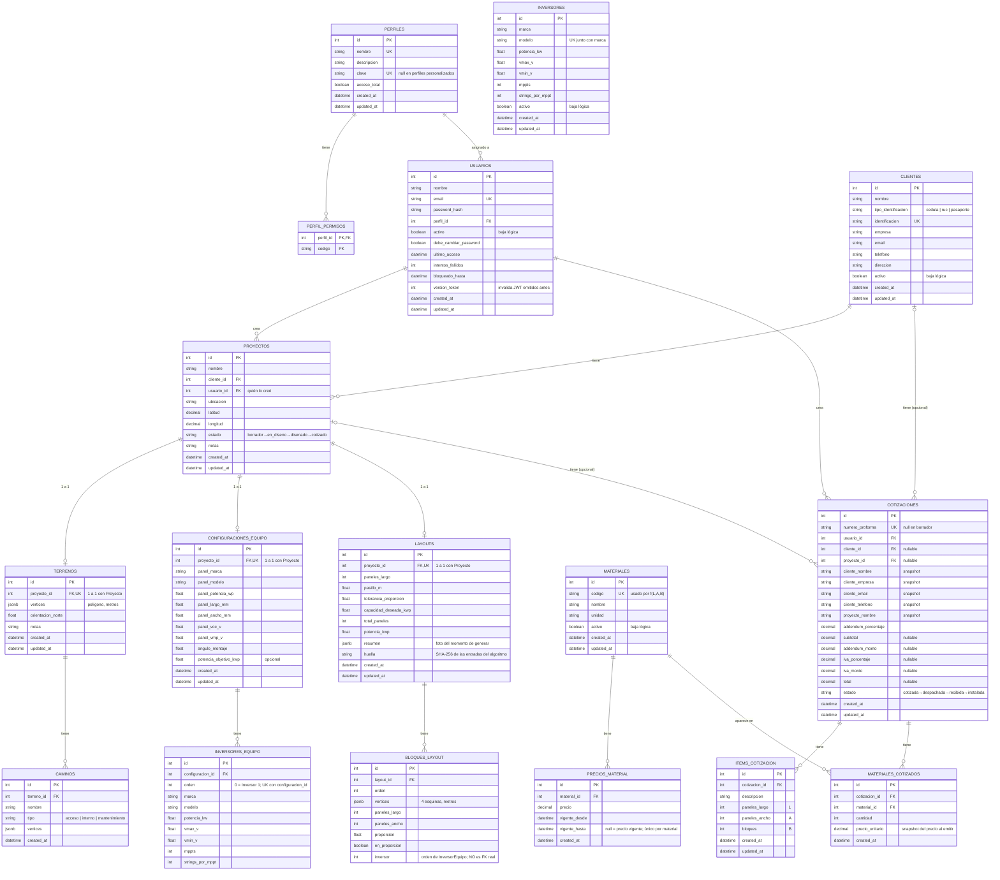

# Diagrama entidad-relación

**Estado:** implementado. Refleja el esquema real en `develop` (después de
`alembic upgrade head`), no una propuesta.

Reemplaza el diagrama ASCII informal que había al final de
[MODELOS-COMPARTIDOS.md](MODELOS-COMPARTIDOS.md): este cubre las 16 tablas
del sistema completo (Módulo 1 de Joseph + Cotización/Materiales/Inversores/
Clientes de Esteban), no solo los modelos compartidos.

---

## Diagrama completo

---

## Notas sobre relaciones que no son llaves foráneas

El diagrama de arriba solo dibuja relaciones con llave foránea real en la
base. Dos casos quedan fuera a propósito, y conviene explicarlos en el
capítulo 7 para que no se confundan con un olvido:

### `Inversor` (catálogo, RF-08) no tiene FK hacia ni desde ningún lado

`Inversor` es un catálogo de referencia. Sirve para **prellenar** el
formulario de `ConfiguracionEquipo` / `InversorEquipo` al configurar el
equipo de un proyecto (RF-02, de Joseph), pero esos datos se copian como
snapshot — no se guarda una referencia (`inversor_id`) al registro del
catálogo. Si más adelante se corrige un inversor en la lista de RF-08, los
proyectos ya configurados no cambian. Es el mismo patrón de snapshot que usa
`Cotizacion` con los datos del cliente.

En términos de ER: `INVERSORES` es una entidad aislada, sin relaciones con
el resto del esquema. La conexión con `CONFIGURACIONES_EQUIPO` /
`INVERSORES_EQUIPO` ocurre solo en la capa de aplicación (el formulario lee
el catálogo), nunca en la base de datos.

### `BloqueLayout.inversor` no es una FK hacia `InversorEquipo`

Cada bloque del layout queda "conectado" a uno de los inversores de la
planta, pero ese campo (`inversor`, un entero) guarda el **`orden`** de
`InversorEquipo` (0 = "Inversor 1"), no su `id`. Es una decisión deliberada
de Joseph (Módulo 1): si el Gerente reemplaza la lista de inversores de un
proyecto, los bloques ya ubicados no deben quedar huérfanos — deben seguir
apuntando al "Inversor 2" de la nueva lista, sea cual sea su fila real. Una
FK real a `inversores_equipo.id` rompería esa garantía.

---

## Patrones del esquema, vistos en el diagrama

- **Baja lógica, nunca `DELETE`:** `activo` en `Usuario`, `Inversor`,
  `Material`, `Cliente`. Ninguna de estas cuatro tablas borra filas.
- **Snapshot al emitir un documento comercial:** `Cotizacion` congela los
  datos del cliente (`cliente_nombre`, `cliente_email`, …) y
  `MaterialCotizado.precio_unitario` congela el precio vigente al momento
  de cotizar, aunque `PrecioMaterial` cambie después.
- **1 a 1 por `unique=True` en la FK**, no por un modelo de herencia:
  `Terreno`, `ConfiguracionEquipo` y `Layout` son, cada uno, como mucho uno
  por `Proyecto`.
- **Un solo precio "vigente" por material:** índice único parcial en
  `precios_material` (`WHERE vigente_hasta IS NULL`), no una columna de
  precio en `Material`.
- **JSONB para geometría y datos de forma libre:** `Terreno.vertices`,
  `Camino.vertices`, `BloqueLayout.vertices` (polígonos) y `Layout.resumen`
  (resultado completo del algoritmo, que no se consulta por partes).
